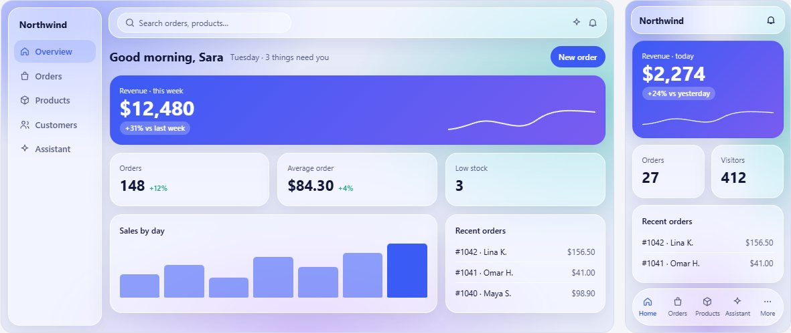

# AI-Skills

A personal collection of [Claude Code Agent Skills](https://code.claude.com/docs/en/skills),
packaged so they can be installed on any machine and shared with others.

The repo is set up three ways at once, so you can install however you like:

1. As a **Claude Code plugin marketplace** (best for using across machines & all projects).
2. As a **symlink/copy install** via `install.sh` (simple, no plugin system needed).
3. As an optional **SessionStart hook** that auto-installs the skills in ephemeral
   environments such as Claude Code on the web.

---

## Skills in this repo

Each skill lives in its own self-contained folder under [`skills/`](./skills) with its
`SKILL.md`, a per-skill **guide** (`README.md` — how to deploy & use it), and its `examples/`
when it has them.

| Skill | Invoke | What it does | Guide |
|-------|--------|--------------|-------|
| ⭐ [`modern-design`](./skills/modern-design) | auto / `/modern-design` | A design playbook for modern dashboards and app shells — desktop and phone, light and dark, LTR and RTL. Shows you seven style samples and asks which you want **before** redesigning, then builds it properly (glass, floating shell, phone tab bar, animation, every component) and reviews the result like a creative director. | [guide](./skills/modern-design/README.md) |
| [`security-test`](./skills/security-test) | auto / `/security-test` | A safe, fully-local security check of a product you own: the repo's own tests plus a code review against a fixed A–H checklist (access control, RLS, injection, client-side, auth, business logic, AI/LLM, platform) on a throwaway database. Never touches production; your findings stay in a private folder. | [guide](./skills/security-test/README.md) |
| [`phone-first-dashboard`](./skills/phone-first-dashboard) | auto / `/phone-first-dashboard` | The engineering of dashboards and admin panels that work on a phone (390 × 844, LTR and RTL): the rules, the component roles, the pitfalls a real phone program paid for, and a phone gate that measures every page. Pairs with `modern-design` for the look. | [guide](./skills/phone-first-dashboard/README.md) |
| [`teach`](./skills/teach) | `/teach` (user-invoked) | Turns the current directory into a stateful teaching workspace and teaches you a topic over multiple sessions — missions, beautiful HTML lessons, reference sheets, spaced-repetition learning records. | [guide](./skills/teach/README.md) |
| [`production-readiness`](./skills/production-readiness) | auto / `/production-readiness` | Audits a codebase for the things teams reliably miss (untested seams, CI, secrets, API resilience, atomic writes, AI cost caps, observability, backups) and returns a severity-ranked report; can drop a checklist + CI into the repo. | [guide](./skills/production-readiness/README.md) |

> `teach` is vendored from [mattpocock/skills](https://github.com/mattpocock/skills)
> (`skills/productivity/teach`). See [Attribution](#attribution). `production-readiness` is
> original, built with Anthropic's `skill-creator` methodology. `modern-design` is original,
> written from a real dashboard redesign and tested by building the same brief with and without it.
> `security-test` and `phone-first-dashboard` are original, extracted from a production multi-tenant
> SaaS where they are updated every round; the public copies are synced from there.

---

## ⭐ Using the `modern-design` skill

Seven modern styles, one sample dashboard — you pick, then Claude builds it.

[](./skills/modern-design/README.md)

**1. Install it** (any option under [Install](#install) below — the quickest):

```
/plugin marketplace add alialzein/AI-Skills
/plugin install ai-skills@ai-skills
```

**2. Ask for a design, in any project:**

```
Redesign my admin dashboard, make it modern.
```

**3. Choose from the samples.** Before changing anything, the skill opens a page with the same
dashboard drawn in seven styles — Aurora Glass, Clean Minimal, Soft Depth, Dark Neon, Bento Bold,
Tonal and Dense Pro — in light and dark, on desktop and phone
([▶ view the samples](https://htmlpreview.github.io/?https://github.com/alialzein/AI-Skills/blob/main/skills/modern-design/assets/style-samples.html)).
It recommends one and asks you to confirm the style, the default theme, the density, the accent
colour, how lively the motion should be, and which screens to start with.

**4. It builds, then reviews.** Tokens first, then the background, surfaces, the shell (floating
sidebar, glass top bar, phone tab bar), pages and components, and motion last — then it checks the
result in both themes, on phone and desktop, scrolled, empty and full of data, and tells you what
is not good enough yet.

Other things to ask it:

```
Here is a screenshot I like — what are these patterns called? Build mine like it.
Review this page like a creative director. What makes it look cheap?
Add a floating bottom tab bar with a sliding neon indicator on the phone.
Animate the charts and the numbers when a page opens.
Make it work in Arabic (right-to-left) and in dark mode.
```

It is a **living** skill: every design round adds what it taught (see its
[CHANGELOG](./skills/modern-design/CHANGELOG.md)). Full guide, all seven previews and the file
map: [`skills/modern-design/README.md`](./skills/modern-design/README.md).

---

## Repo layout

```
AI-Skills/
├── .claude-plugin/
│   ├── plugin.json              # makes this repo an installable plugin
│   └── marketplace.json         # ...and a marketplace that lists that plugin
├── skills/
│   ├── modern-design/
│   │   ├── SKILL.md             # choose a style → order of work → laws → red flags
│   │   ├── references/          # styles, every component, glass, shell, phone, motion, review
│   │   ├── assets/              # style-samples.html (7 styles) + modern.css (tokens, recipes)
│   │   ├── scripts/             # contrast.mjs — text contrast on translucent surfaces
│   │   ├── examples/previews/   # a picture of each style
│   │   ├── CHANGELOG.md         # what was learned, and when
│   │   └── README.md
│   ├── teach/
│   │   ├── SKILL.md             # the skill definition (frontmatter + instructions)
│   │   ├── *-FORMAT.md          # templates the skill references
│   │   ├── README.md           # how to deploy & use this skill
│   │   └── examples/
│   │       └── leadership-course/   # a full worked example (7-lesson course)
│   ├── security-test/
│   │   ├── SKILL.md             # safety contract → privacy rule → the loop
│   │   ├── references/          # review procedure, A–H catalog, profile / log / fix-list templates
│   │   └── examples/            # one run on a fictional product
│   ├── phone-first-dashboard/
│   │   ├── SKILL.md             # phone rules → component roles → pitfalls → the gate
│   │   └── references/          # pitfalls by topic, building a phone gate
│   └── production-readiness/
│       ├── SKILL.md            # lean workflow (progressive disclosure)
│       ├── references/         # detailed checklist, grep recipes, stack profiles
│       ├── assets/             # drop-in repo checklist + report template
│       ├── examples/           # a worked sample review
│       └── README.md
├── install.sh                   # symlink/copy skills into ~/.claude/skills
├── .claude/
│   ├── hooks/install-skills.sh  # SessionStart hook (auto-install in web/ephemeral)
│   └── settings.json.example    # opt-in: enables the hook above
├── .gitignore · LICENSE · README.md
```

Convention: a skill is any `skills/<name>/` folder containing a `SKILL.md`. Anything else in
the folder (`README.md`, `examples/`, `references/`, `assets/`) is for humans or loaded
on demand — it doesn't interfere with skill discovery.

---

## Install

### Option 1 — As a plugin (recommended for cross-machine use)

Inside Claude Code:

```
/plugin marketplace add alialzein/ai-skills
/plugin install ai-skills@ai-skills
```

This makes the skills available in **every** project on that machine, with proper
versioning. Update later with `/plugin marketplace update ai-skills`.

### Option 2 — Symlink into your personal skills (single machine)

```bash
git clone https://github.com/alialzein/ai-skills.git
cd ai-skills
./install.sh           # symlinks each skill into ~/.claude/skills/<name>
# or: ./install.sh --copy   (copy instead of symlink; for ephemeral/CI environments)
```

`install.sh` links **each skill folder individually** into `~/.claude/skills/`
(symlinking the whole `~/.claude/skills` directory is not supported by Claude Code).
Re-running it is safe and idempotent; `git pull` keeps symlinked skills up to date.

### Option 3 — Auto-install in Claude Code on the web (ephemeral containers)

In web/ephemeral sessions, `~/.claude/skills` is wiped between sessions. To
re-install the skills automatically at the start of every session in this repo:

```bash
cp .claude/settings.json.example .claude/settings.json
```

That activates the `SessionStart` hook in `.claude/hooks/install-skills.sh`, which
copies the skills into `~/.claude/skills` and asks Claude Code to reload them.
`.claude/settings.json` is gitignored, so this stays a local, opt-in choice.

---

## Using the `teach` skill

`teach` is **user-invoked** (it sets `disable-model-invocation: true`), so you call it
explicitly. It treats your **current directory** as a persistent learning workspace.

```bash
mkdir ~/learn-spanish && cd ~/learn-spanish
# then, in Claude Code:
/teach Spanish for ordering food while travelling in Mexico
```

What happens:

- It first asks **why** you want to learn this and writes a `MISSION.md` to ground everything.
- It curates trusted sources into `RESOURCES.md` (it won't rely on guesswork).
- It produces short, beautiful **lessons** as self-contained HTML in `./lessons/`.
- It keeps reference sheets in `./reference/`, a `GLOSSARY.md`, and `learning-records/`
  that track what you've learned so later sessions pick up where you left off.

Because all state lives in that directory, keep using the **same folder** each session
(commit it to its own git repo if you want history). Run `/teach` again any time to
continue, and answer its questions to steer what it teaches next.

---

## Examples

Examples live **with their skill**:

- [`skills/modern-design/assets/style-samples.html`](./skills/modern-design/assets/style-samples.html) —
  one sample dashboard in seven modern styles, light and dark, desktop and phone
  ([▶ view](https://htmlpreview.github.io/?https://github.com/alialzein/AI-Skills/blob/main/skills/modern-design/assets/style-samples.html));
  a picture of each style is in [`examples/previews/`](./skills/modern-design/examples/previews).
- [`skills/teach/examples/leadership-course/`](./skills/teach/examples/leadership-course) —
  a real, worked `teach` workspace ("How to be a strong leader"): a full 7-lesson course with
  mission, curated resources, a glossary, seven interactive HTML lessons, and a printable
  reference card. Its [README](./skills/teach/examples/leadership-course/README.md) has
  one-click links to view the rendered lessons.
- [`skills/security-test/examples/sample-run.md`](./skills/security-test/examples/sample-run.md) —
  one security run start to finish on a fictional product: safety gate, repo tests, catalog review,
  verification, report.
- [`skills/production-readiness/examples/sample-review.md`](./skills/production-readiness/examples/sample-review.md) —
  a worked production-readiness review showing the report shape and severity ranking.

---

## Adding a new skill

1. Create `skills/<your-skill>/SKILL.md` with frontmatter:
   ```markdown
   ---
   name: your-skill
   description: One line on what it does AND when Claude should use it.
   ---

   Instructions for the skill go here.
   ```
   (`name` must be lowercase, match the folder, and be ≤64 chars. Add
   `disable-model-invocation: true` for a user-only `/your-skill` command.)
2. Add a `skills/<your-skill>/README.md` (deploy + use guide) and, if you have one, an
   `examples/` folder beside `SKILL.md`. Put long reference material in `references/` and
   templates/output files in `assets/` so `SKILL.md` stays lean (progressive disclosure).
3. Add a row to the [Skills table](#skills-in-this-repo) above.
4. Re-run `./install.sh` (or `/plugin marketplace update ai-skills` for plugin users).

---

## Attribution

The `teach` skill is authored by **Matt Pocock** and vendored from
[mattpocock/skills](https://github.com/mattpocock/skills). All credit for it goes to
the original author; it is included here per that repository's license. Everything
else in this repo (packaging, install tooling) is MIT-licensed — see [LICENSE](./LICENSE).
