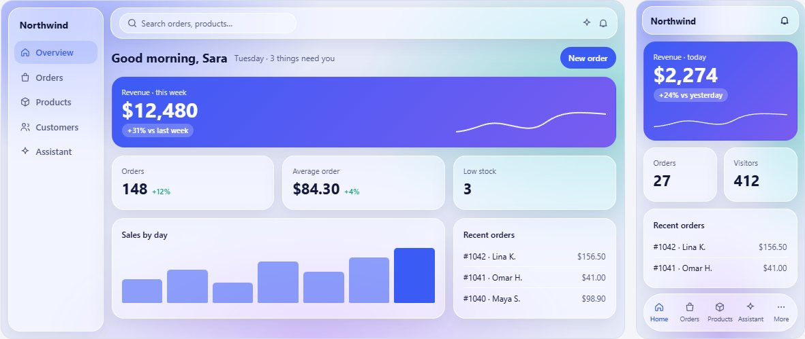
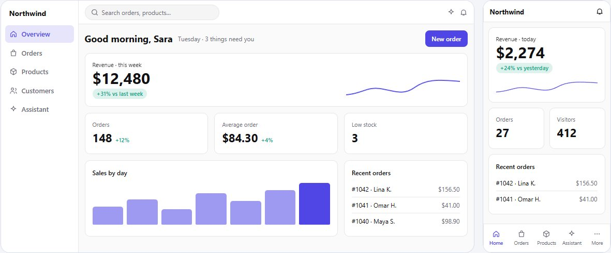
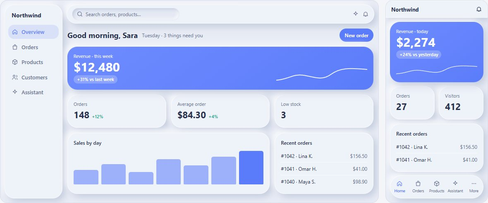
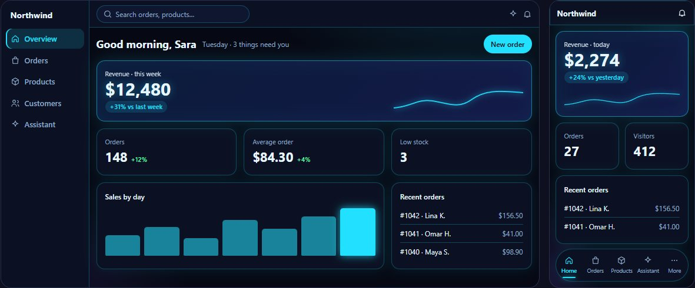
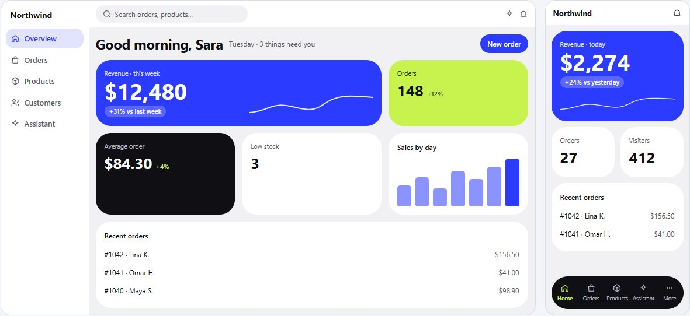
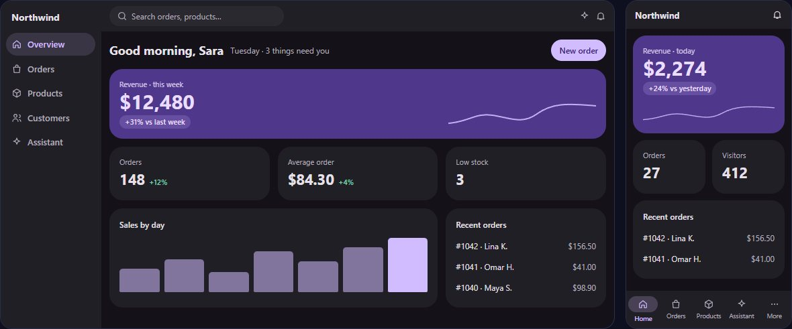
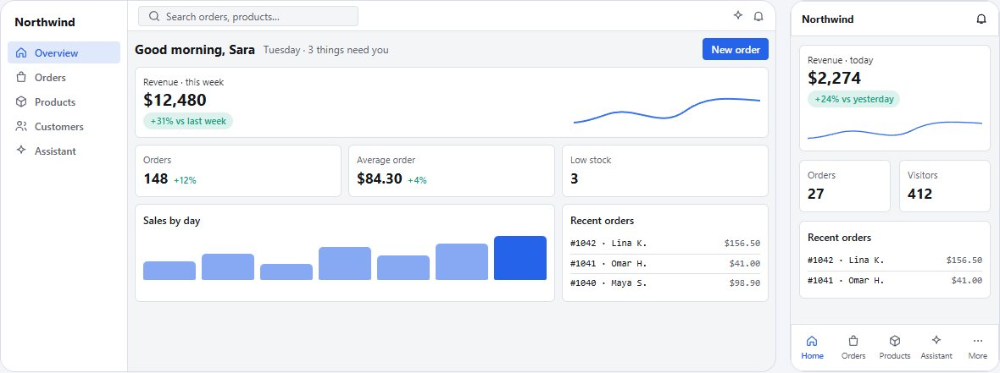
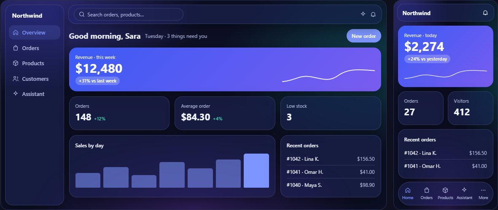

# `modern-design` — skill guide

A design playbook for building, redesigning and **reviewing** modern dashboards, admin panels and
app shells — desktop and phone, light and dark, left-to-right and right-to-left. It makes Claude
show you style samples and ask what you want **before** it redesigns anything, then build it the
way a careful design team would: tokens first, then the background, the surfaces, the shell, the
pages, the motion — and a review against a reference until it holds.

It was written from a real redesign of two production dashboards, reviewed round by round against
the owner's reference screenshots and videos. Every rule in it is there because a first draft got
it wrong.

- **Invoke:** model-invoked. It triggers when you ask to design, redesign, restyle or review a
  dashboard / admin / SaaS screen, or use words like *modern, premium, glassy, neon, animated*.
  You can also force it with `/modern-design`.
- **Best for:** web dashboards and app shells in any framework (plain CSS variables and markup;
  works with React, Next.js, Vue, Tailwind or none).
- **Not for:** marketing landing pages and editorial sites.

## Pick a style from samples

The skill ships one small dashboard drawn in **seven styles** — open
[`assets/style-samples.html`](./assets/style-samples.html) in a browser
([▶ view online](https://htmlpreview.github.io/?https://github.com/alialzein/AI-Skills/blob/main/skills/modern-design/assets/style-samples.html)),
switch light / dark, and look at the desktop and the phone side by side.

| | |
|---|---|
| **1 · Aurora Glass** — frosted panels over a soft colour wash  | **2 · Clean Minimal** — solid surfaces, thin lines, one accent  |
| **3 · Soft Depth** — gently raised, friendly controls  | **4 · Dark Neon** — deep dark, glowing lines  |
| **5 · Bento Bold** — big coloured blocks, large numbers  | **6 · Tonal** — every surface a tint of one colour  |
| **7 · Dense Pro** — compact, data-heavy, for operators  | **Aurora Glass, dark**  |

## Use it

Just ask, in any project:

```
Redesign my admin dashboard, make it modern.
```

What happens:

1. **It shows you the samples and asks** — which style, the default theme (light / dark / follow
   the device), comfortable or compact, the accent colour, how lively the motion should be, and
   which screens to do first. It recommends one and says why, but it does not guess your taste —
   even if you say "you choose".
2. **It builds in order:** design tokens → the background → the surface recipe → the shell
   (sidebar, top bar, phone tab bar) → pages and components → motion.
3. **It reviews its own work** against the sample or your reference: both themes, phone and
   desktop, scrolled and at rest, empty and full of data — and lists what is not good enough yet.

More things to ask:

```
Here is a screenshot of a dashboard I like. What are these patterns called, and build mine like it.
Review this page like a creative director — what makes it look cheap?
Add a floating bottom tab bar with a sliding neon indicator for the phone layout.
Animate the charts and numbers when the page opens.
Design the AI chat panel: rich cards in replies, a "what the assistant did" timeline.
Make this work in Arabic (right-to-left) and in dark mode.
```

If you already have a reference (a screenshot, a reel, a video), give it — the skill names the
patterns in it and builds to match.

## What's in here

| Path | Role |
|------|------|
| `SKILL.md` | The workflow: choose the style → the order of work → 15 laws → the red flags of a first draft. |
| `assets/style-samples.html` | The seven-style sample page shown before a redesign. |
| `assets/modern.css` | Working tokens and recipes (glass, floating shell, the neon tab bar, page and chart motion) to copy. |
| `references/styles.md` | The seven styles: the look, what each suits, what goes wrong, which to pick when. |
| `references/component-library.md` | Every component — buttons, inputs, tables, tabs, dialogs, menus, toasts, navigation — with states and per-style notes. |
| `references/glass.md` | The glass recipe: background, surfaces, contrast, performance. |
| `references/shell-desktop.md` | Floating sidebar, glass top bar, the scroll veil, search, icon rail. |
| `references/phone.md` | The floating tab bar with its sliding neon line, sheets, the "More" screen, right-to-left traps. |
| `references/components.md` | Dashboard compositions: hero card, stat tiles, charts and empty states, portrait cards, profile page, OTP input, AI chat. |
| `references/motion.md` | Which animation goes where, the rules that keep it fast, charts and numbers in motion. |
| `references/review.md` | How to review a design and write change requests; the faults first drafts usually have. |
| `references/vocabulary.md` | The names of the patterns, so you can ask for them. |
| `scripts/contrast.mjs` | Checks text contrast on translucent surfaces: `node scripts/contrast.mjs spec.json`. |
| `CHANGELOG.md` | What was learned, and when. |

Only `SKILL.md` loads when the skill triggers; the references load when the work needs them.

## Deploy it

> Repo-wide options are in the [root README](../../README.md#install). Quick paths:

**Plugin (recommended, all machines):**
```
/plugin marketplace add alialzein/AI-Skills
/plugin install ai-skills@ai-skills
```

**Single skill, by hand** — copy the whole folder, keeping the name `modern-design`:
```bash
cp -r skills/modern-design ~/.claude/skills/modern-design   # macOS/Linux
# Windows: C:\Users\<you>\.claude\skills\modern-design\
```
Or from the repo root run `./install.sh` to symlink every skill into `~/.claude/skills/`.

## A living skill

This skill is meant to grow. After a design round teaches something — a pitfall and its fix, a
value that worked, a choice the owner made against the advice — it goes into the right reference
file, the red-flag list if it is a new symptom, and one dated line in `CHANGELOG.md`. Choices that
overrule the skill are recorded as options, not deleted: taste is data.

To add your own lessons, edit the reference file and add a `CHANGELOG.md` line; pull requests are
welcome.

## How it was tested

The same brief ("a premium glass dashboard, desktop and phone, light and dark, Arabic too") was
built by an agent without the skill and with it. Without: page content showed above the floating
top bar while scrolling, and blur, width and shadow were animated, some in endless loops. With the
skill: none of those, a hero-first phone layout, and designed empty states. A vague request
("make it modern, you choose, I have an hour") was run twice to make sure the skill shows the
samples and asks first.
